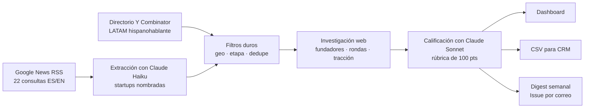

# Latin Leap Scout

Herramienta automatizada de sourcing que incrementa el **dealflow calificado** de Latin Leap.
Cada lunes detecta startups pre-seed y seed de América Latina hispanohablante en fuentes
públicas, las investiga, las califica contra la tesis del fondo y entrega el resultado al
equipo, sin operación manual.

**Dashboard:** https://rodrigomaza.github.io/latin-leap-scout/
**Digest semanal:** pestaña [Issues](../../issues) (GitHub lo envía por correo)

---

## El problema

- Meta del reto: +10% sobre un baseline de 60 deals/mes → **+6 deals calificados al mes**.
- Latin Leap es un equipo de ~3 personas con ~15 inversiones por fondo: **la calidad pesa
  más que el volumen**. Un deal que no encaja con la tesis le cuesta tiempo al equipo.

Por eso la herramienta no busca *más* startups, busca startups **que ya pasaron el primer
filtro de un Associate**, con la justificación lista para leer en 10 minutos.

## Por qué outbound y no inbound

Optimizar el formulario de aplicación solo sube el dealflow si ya existe demanda que se
pierde, y eso no se puede demostrar en 48 horas. El sourcing outbound agrega startups que
hoy el equipo no ve y se puede medir desde la primera corrida.

## Cómo funciona



1. **Recolecta** (`sources.py`): noticias de rondas, lanzamientos y aceleradoras
   de los últimos 7 días, más startups de batches recientes de YC con sede en LATAM
   hispanohablante. Solo fuentes públicas: no hay scraping de LinkedIn ni Crunchbase,
   porque sus términos lo prohíben.
2. **Extrae y filtra** (`llm.py → extract`): Claude lee los titulares en lote y
   extrae startups concretas. Se descartan Brasil, EE.UU., España, Serie A en adelante
   y las que ya están en el pipeline. Si una startup ya conocida vuelve a aparecer en
   noticias, se registra como señal de momentum.
3. **Investiga** (`research`): por cada candidata, Claude hace hasta 3 búsquedas web:
   sitio, fundadores y su experiencia, rondas, tracción y modelo comparable.
4. **Califica** (`score`): rúbrica explícita basada en la tesis.
5. **Entrega** (`report.py`): dashboard, CSV y digest con borrador de primer
   contacto para cada founder.

## La tesis, codificada

La rúbrica sale de las fuentes públicas del fondo y de su portafolio real (`config.py`):

| Criterio | Pts | De dónde sale |
|---|---:|---|
| Equipo | 30 | El fondo dice: "la idea es el 1%, el equipo el 99%". |
| Sector | 20 | Patrones del portafolio: fintech para pymes y segmentos desatendidos (Morado, Cubo, Luable), infraestructura para comercio pequeño y logística (Rintin, PuntoPost), IA/SaaS (Keybe, Dapta). |
| Modelo probado | 10 | ADN Rocket Internet del fundador (Dafiti = "el Zalando de LATAM"; PuntoPost = "el InPost de LATAM"). |
| Tracción | 20 | Para seed buscan ventas y tracción reales. |
| Etapa y timing | 20 | Cheques pre-seed/seed de ~US$250-500K. Mejor si está levantando ahora. |

**Filtros duros:** LATAM hispanohablante, pre-seed/seed y base tecnológica. Si alguno falla,
la startup se descarta.

El **total lo suma el código, no el modelo**: cada criterio se acota a su máximo, así que
el puntaje es reproducible y auditable. Umbral de deal calificado: **65/100**; alto fit: **78**.

## Calibración: ¿piensa como Latin Leap?

`python calibrate.py` corre el mismo flujo sobre **el portafolio real** del fondo y
sobre **controles fuera de tesis** (Brasil, España, EE.UU.). Si el portafolio sale alto y
los controles salen bajo, el calificador está alineado con cómo invierte el fondo. El
resultado aparece en el dashboard.

## Automatización

| Workflow | Cuándo | Qué hace |
|---|---|---|
| `scout.yml` | Lunes 06:17 CDMX + botón manual | Prueba simulada, pipeline completo, guarda resultados y publica el digest |
| `calibrate.yml` | Manual | Recalibra contra el portafolio |

Todo corre en GitHub Actions (gratis). La API key vive cifrada en *Secrets*. El estado
(deals vistos, historial de corridas) se versiona en `data/`, así que cada corrida es
auditable en el historial del repositorio.

## Costo

Haiku hace el trabajo de volumen (leer titulares, investigar) y Sonnet el juicio de
inversión. Hay un **tope de US$1.20 por corrida** (`MAX_USD_PER_RUN`): si se alcanza, lo
pendiente pasa a la siguiente semana. El costo de cada corrida queda registrado en el
dashboard.

## Cómo se mide el +10%

`deals calificados en 30 días ÷ 60`. Esto supone que esas startups no estaban ya en el
pipeline del fondo. **Siguiente paso natural:** marcar en el dashboard las que el equipo
ya conocía y retroalimentar al calificador con las que sí avanzan a primera llamada.

## Limitaciones conocidas

- Google News entrega titulares y resúmenes, no el artículo completo. La investigación
  web compensa, pero algunas startups muy nuevas tienen poca huella pública.
- El calificador es un primer filtro, no una decisión de inversión: la confianza
  (alta/media/baja) indica cuánta evidencia encontró.
- El borrador de contacto siempre debe revisarse antes de enviarse.

## Estructura

```
config.py            tesis, fuentes, umbrales y límites de costo
sources.py           Google News RSS + directorio YC
llm.py               extracción, investigación web y calificación
main.py              orquestación y deduplicación
store.py             estado persistente (deals vistos, corridas)
report.py            dashboard, CSV y digest
calibrate.py         calibración contra el portafolio
offline_test.py      prueba de punta a punta sin API
index.html           dashboard (GitHub Pages)
data/                estado persistente versionado
reports/             digests semanales
.github/workflows/   automatización
```

Construido por Rodrigo Maza para el proceso de VC Associate de Latin Leap, con Claude como
herramienta de desarrollo.
